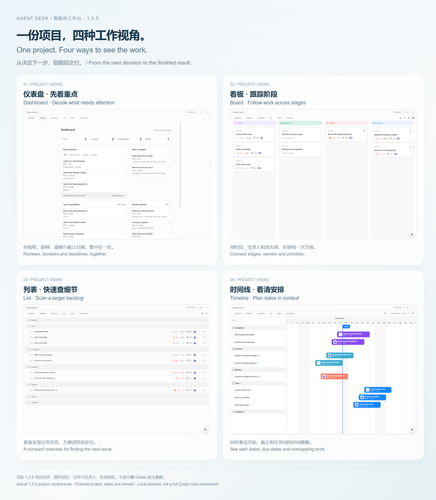

# Agent Desk · 智能体工作台

**Turn scattered agent conversations into work you can track, review and finish.**

**把分散的智能体对话，组织成可追踪、可审阅、可完成的项目。**

[Download for Windows](https://github.com/texasisalwaysbusy/agent-desk/releases/tag/v1.2.5) · [简体中文](README.zh-CN.md) · [Screenshots](docs/showcase.md) · [Changelog](CHANGELOG.md)

Agent Desk is a local project workspace inside the official Codex desktop app on Windows. Keep tasks, deadlines, agent assignments and human review in one place: see what needs attention, return to the conversation behind a task, and decide what is ready to move forward.

It is independently maintained and derived from Dashi Taskboard. It is not an OpenAI product or an official upstream release. [Attribution](NOTICE) · [License](docs/licensing.md)



*Actual 1.2.5 project UI with fictional demo data, rendered locally. Bilingual captions explain each view; no real projects, accounts or agent runs are shown.*

## One project, several ways to work

| When you need to… | Agent Desk helps you… |
| --- | --- |
| Decide what to handle next | Use the dashboard to find reviews, blockers, overdue work and upcoming deadlines. |
| Follow work across stages | Move through a task board with owners, priorities, labels and dates. |
| Scan a larger backlog | Use the compact list, search and filters to find the next issue. |
| Plan a sequence of work | Put start and due dates on a Gantt timeline. |
| Understand how a result was produced | Keep descriptions, comments and attachments with the task, and return to its linked Codex conversation. |
| Review an agent handoff | Inspect the proposed operations and risks through a separately configured local approval integration. |
| Pace longer sessions | Read remaining 5-hour and weekly usage allowances and reset countdowns in the native sidebar. |

### See usage allowances and reset times


See remaining **5-hour and weekly allowances**, plus reset countdowns, without opening a separate dashboard. Bar length shows the remaining percentage. The entire fill uses one continuous state colour: clear blue/cyan when plentiful, a stable healthy green, then orange and red as the allowance falls. Soft vertical highlights give the static bar a restrained glass-and-liquid finish. These are usage limits, not a cash balance.

*Updated preview: actual quota component 1.0.15, with fictional values in illustrative Chinese/light and English/dark sidebars. The state comparison uses the same component. This is not a full Codex client screenshot. [How allowances work](docs/usage-allowance.md).*

### Keep the workflow visible

Tasks move through To do, In progress, Blocked and In review. You can distinguish an agent's assignment from the result that still needs a person to check. A task marked “In progress” does not by itself prove that an agent is currently running.

### See the schedule, not just the queue

Use dates to see how work overlaps and what is coming next. Prefer a compact overview? The [gallery](docs/showcase.md) also shows the list view.

### Read the material before making a decision


The approval center groups the same file version across operations, so shared evidence is read once. It distinguishes complete, preview, missing, unverifiable and conflicting material. Incomplete material disables approval while return and reject remain available. [Review rules](docs/approval-material-review.md).

The approval center presents human-readable handoff details when the local receiver integration is configured. Receiving a request, claiming a task and moving a task to review are different events. A review decision does not automatically start an agent or grant open-ended command access.

Project automation prepares requests for Codex's native Scheduled tasks. Agent Desk does not add its own background scheduler. The task CLI and local MCP plugin support agent access to project work.

## A practical first workflow

1. Install Agent Desk, then start Codex through the Agent Desk tray after exiting any ordinary Codex session normally.
2. Open the workbench, choose a project and create tasks with a clear outcome, owner and due date.
3. Link the relevant conversation and use the board or list to track progress.
4. Review results, resolve blockers and mark accepted work complete. Use the dashboard for the next decision.

## Download and compatibility

**[Agent Desk 1.2.5 · Windows x64 installer](https://github.com/texasisalwaysbusy/agent-desk/releases/download/v1.2.5/Agent-Desk-1.2.5-Windows-x64-setup.exe)**

[Release notes and SHA-256](https://github.com/texasisalwaysbusy/agent-desk/releases/tag/v1.2.5) · [Known issues and candidate status](docs/known-issues.md)

The public stable release is **v1.2.5**. The current-user installer is unsigned. Automatic updates are disabled; login autostart is optional. Only Windows x64 is supported.

1.2.5 replaces repeated shell-based process checks with a persistent native observer and adds clearer bounded diagnostics, without extending timeouts or retry limits. The candidate completed about 5.5 externally supervised hours without recorded observation failures; the user then reported tens of hours of normal use across four days without recurrence and accepted publication. Controlled failure, recovery and normal exit were not completed in that field round. The additional approval-material UI was checked offline. [Release notes and exact scope](docs/release-1.2.5.md).

Exit Codex and the old tray normally before installing or starting through Agent Desk. Preserve the old installation and data for rollback; do not run two launchers at once. Renderer compatibility is checked structurally on each new document; future Codex versions are not guaranteed compatible. Live approval execution has separate setup and acceptance requirements.

## Local data and clear boundaries

New installations store application data under `%LOCALAPPDATA%\AgentDesk`; existing legacy stores are reused without an automatic move. Ambiguous stores produce an error rather than an automatic merge. See [compatibility](docs/product-identity.md) and [privacy](PRIVACY.md).

The launcher uses the registered official Store package and the existing login profile, validates identity and signatures, and opens a random `127.0.0.1` Codex debugging listener. Other same-machine processes can reach that listener; it is not protected by the workbench API's authentication. Agent Desk does not modify the official package or read authentication databases, and it does not attach to an ordinary running Codex. Normal Codex exit closes its debugging listener.

## Build and contribute

Use Node.js 24 and npm. Windows packaging also needs Rust stable 1.88+, the MSVC C++ workload and Windows SDK.

```powershell
npm ci
npm run check
npm run app:build:windows
```

`npm run dev` runs a local development preview; `npm run agentdesk -- --help` shows CLI usage. Read [AGENTS.md](AGENTS.md), [architecture](docs/architecture.md) and [startup diagnostics](docs/startup-diagnostics.md). Bug reports are most useful with version, steps, expected/actual behavior and sanitized diagnostics; do not include tokens or private conversations.

## Source and license

**Source-available. Covered Agent Desk additions and modifications use Apache-2.0 with Commons Clause 1.0.** Upstream Dashi portions retain Apache-2.0; third-party components retain their own licenses.

Use, study, modify and redistribute the covered software free of charge, including internal business use. Selling the software or a product/service whose value derives entirely or substantially from its functionality requires separate permission from the relevant rights holders. Ordinary paid work performed using the tool is not prohibited merely because it is paid. This combined license is not OSI-approved open source.

[LICENSE](LICENSE) · [NOTICE](NOTICE) · [Licensing examples](docs/licensing.md) · [Curated source publishing](docs/publishing.md)
